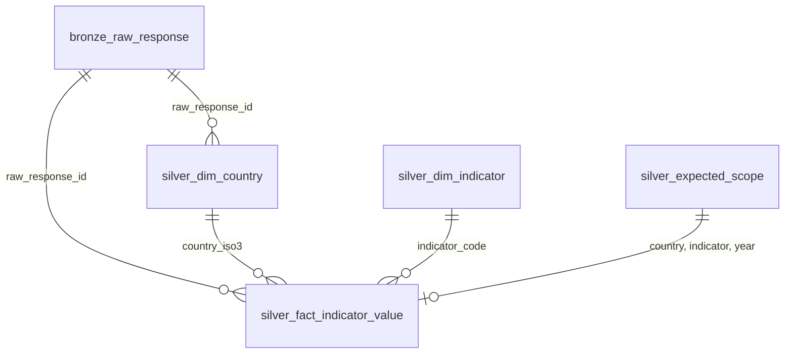

# World Bank Indicators Pipeline

A small, local, configuration-driven pipeline that pulls yearly country indicators from the public
[World Bank API v2](https://datahelpdesk.worldbank.org/knowledgebase/articles/889392), stores the raw
responses, builds a clean analytics model in DuckDB, runs data-quality checks, and exports reporting
views to CSV.

- **Countries:** BRA, CAN, DEU, GBR, IND, JPN, MEX, USA, ZAF
- **Indicators:** `SP.POP.TOTL`, `NY.GDP.MKTP.CD`, `NY.GDP.PCAP.CD`, `SP.DYN.LE00.IN`
- **Years:** 2018–2024
- **Stack:** Python 3.11+ · requests · DuckDB · PyYAML · pytest

---

## Quick start

```bash
git clone https://github.com/c0lper/worldbank-pipeline.git
cd worldbank-pipeline

python -m venv .venv
# Windows (PowerShell): .venv\Scripts\activate
# macOS / Linux:        source .venv/bin/activate
pip install -r requirements.txt

python -m pipeline run        # the single command: fetch -> bronze -> silver -> DQ -> gold -> reports/
python -m pytest              # tests (no network access needed)
```

Other commands:

| Command | What it does |
|---|---|
| `python -m pipeline run` | Calls the API, stores raw pages, rebuilds silver, runs DQ checks, refreshes gold views and `reports/*.csv` |
| `python -m pipeline rebuild` | Reprocesses the latest stored raw responses **without calling the API** (replay) |
| `python -m pipeline run --config other.yaml` | Same, with another config file |

The database is created at `data/worldbank.duckdb`. To explore it: `duckdb data/worldbank.duckdb`
(DuckDB CLI) or from Python with `duckdb.connect("data/worldbank.duckdb")`, then e.g.
`SELECT * FROM gold_yoy_change WHERE country_iso3 = 'MEX'`.

No cloud resources, accounts or API keys are used.

---

## Repository layout

```
config.yaml              countries, indicators, years, API and DQ settings
pipeline/
  api.py                 World Bank client: paging, retries, payload validation
  bronze.py              stores every API response page verbatim (raw layer)
  silver.py              parses raw -> typed dims + fact, idempotent upsert
  quality.py             data-quality checks, results stored per run
  gold.py                creates analytics views and exports CSVs
  run.py, __main__.py    orchestration, run log, CLI
sql/
  schema.sql             physical data model
  gold/*.sql             reporting views (one file per question)
tests/                   offline tests with a fake World Bank API
reports/                 sample output of the reporting views (committed)
```

---

## Architecture

```
World Bank API ──> bronze_raw_response ──> silver_* (dims, fact, expected scope) ──> DQ checks ──> gold_* views ──> reports/*.csv
                   (raw JSON, immutable)    (typed, standardized)                    (block on error)
```

1. **Ingest (bronze).** One request for country metadata plus one request per indicator (all
   countries and the full year range in a single call, e.g.
   `/country/BRA;CAN;.../indicator/SP.POP.TOTL?date=2018:2024&format=json&per_page=1000`). Every page
   is followed until `page == pages`, and the number of records received is checked against the
   API's `total`. All pages are fetched before anything is written, so a failed run leaves no
   partial raw data.
2. **Model (silver).** Raw JSON is parsed from bronze (not from memory), filtered to the configured
   scope, typed and upserted.
3. **Data quality.** Checks run on silver. Any `error` check fails the run and gold/reports are not
   refreshed, so analysts keep the last good version.
4. **Report (gold).** SQL views answer the four questions and are exported to `reports/`.

### API failure handling

- Retries with exponential backoff (2s, 4s, 8s, 16s; configurable) on timeouts, connection errors,
  HTTP 429/5xx and invalid JSON (the API sometimes returns an HTML error page under load).
- No retries on other 4xx; fails fast with the response body in the error.
- The API can return **HTTP 200 with an error message** (e.g. invalid indicator code); this is
  detected and raised.
- `[meta, null]` responses (no data) are treated as zero records, not as an error.

---

## Data model



| Table | Layer | Grain | Business key |
|---|---|---|---|
| `bronze_raw_response` | raw | one distinct API response page | `raw_response_id` = hash(request URL + body) |
| `silver_dim_country` | clean | one country | `country_iso3` |
| `silver_dim_indicator` | clean | one indicator (from config) | `indicator_code` |
| `silver_expected_scope` | clean | country × indicator × year requested by config | (`country_iso3`, `indicator_code`, `year`) |
| `silver_fact_indicator_value` | clean | country × indicator × year returned by the API | (`country_iso3`, `indicator_code`, `year`) |
| `gold_*` | analytics | views, see below | — |
| `meta_pipeline_run`, `meta_dq_result` | ops | one run / one check per run | `run_id` (+ `check_name`) |

Key columns of the fact table: `value` (DOUBLE, **NULL when missing — never 0**), `value_status`
(`available` / `null_in_source`), `obs_status`, `source_last_updated` (the API's `lastupdated`),
`raw_response_id` (lineage), `first_loaded_at_utc`, `updated_at_utc`.

**Standardization** — analysts never see the API format: ISO-3 codes everywhere (the API mixes ISO-2
and ISO-3), `date` string → integer `year`, numeric values as DOUBLE, nested JSON flattened into named
columns (`income_level`, `region`, ...), trimmed names, friendly indicator names and units from config.

**Traceability** — every fact and country row has a `raw_response_id` pointing to the exact stored
response body (plus its URL, page, fetch time and SHA-256). Example:

```sql
SELECT f.*, b.request_url, b.fetched_at_utc, b.payload_json
FROM silver_fact_indicator_value f
JOIN bronze_raw_response b USING (raw_response_id)
WHERE f.country_iso3 = 'MEX' AND f.indicator_code = 'SP.POP.TOTL' AND f.year = 2023;
```

**Idempotency** — re-running with unchanged source data creates nothing new:
- bronze: the id is a content hash, so an identical response is not stored twice;
- silver: facts are compared on their business key; only new keys are inserted and only keys whose
  value changed are replaced (`first_loaded_at_utc` is preserved). Each run logs inserted / updated /
  unchanged counts in `meta_pipeline_run`;
- gold: views over silver, CSVs are fully rewritten.

---

## Analytics outputs

| Question | View | Sample output |
|---|---|---|
| Which country-indicator-year combinations are missing or incomplete? | `gold_missing_values` (row level, with `missing_reason` = `null_in_source` or `not_returned`) and `gold_coverage_summary` (per country × indicator: completeness %, missing years) | `reports/missing_values.csv`, `reports/coverage_summary.csv` |
| Year-over-year change, handling missing or zero prior values | `gold_yoy_change` | `reports/yoy_change.csv` |
| Country comparison for the latest available year of each indicator | `gold_latest_comparison` | `reports/latest_comparison.csv` |
| Indicators by income group and year | `gold_income_group_by_year` | `reports/income_group_by_year.csv` |
| Data-quality results of the run that produced the reports | `meta_dq_result` | `reports/data_quality_results.csv` |

Rules worth knowing:

- **YoY** compares with the immediately previous calendar year (no gap filling). `pct_change` is
  NULL when it cannot be computed and `yoy_status` says why: `current_missing`, `prior_missing`,
  `prior_zero` (absolute change is still given) or `prior_year_not_in_range` for 2018.
- **Latest comparison** shows each country at its own latest year with a value and adds
  `years_behind_latest`, so a 2023 value is never silently compared against 2024 values.
- **Income groups** use the aggregation defined per indicator in `config.yaml`: `sum` for population
  and GDP, **population-weighted average** for GDP per capita and life expectancy (a plain average
  of per-capita figures would be wrong). Only countries with data are aggregated;
  `countries_reporting` and `coverage_status` (`complete` / `partial` / `no_data`) flag incomplete groups.

---

## Data quality and tests

Checks (`pipeline/quality.py`), stored per run in `meta_dq_result`:

| Check | Severity |
|---|---|
| Fact business key is unique; country key is unique | error |
| `value_status` consistent with `value` | error |
| Every fact has a matching country and indicator | error |
| Every fact is traceable to a stored raw response | error |
| Values within the configured `valid_range` per indicator | error |
| **GDP per capita ≈ GDP / population** within 2% (configurable `consistency_rules`) | warn |
| Every expected country-indicator-year was returned by the API | warn |
| Share of missing values below `max_missing_pct` | warn |

Errors stop the run before gold is refreshed. Warnings are logged and recorded: missing data is an
expected, meaningful outcome of this source, and a small consistency difference is reported rather
than hidden or "fixed".

Tests (`python -m pytest`) run fully offline against a fake World Bank API that serves
API-shaped payloads. They cover paging, retries/backoff, error payloads, truncated results, null
handling, idempotent re-runs (bronze, silver, reports byte-identical), corrected source values,
replay from bronze, adding a country via config, every DQ check, and each gold view's edge cases.

---

## Configuration: adding a country or indicator

Everything is driven by `config.yaml`; no code changes are needed.

- **Country:** add its ISO-3 code to `countries`.
- **Indicator:** add an entry under `indicators` with `code`, `name`, `unit`, `aggregation`
  (`sum` or `weighted_avg` + `weight_indicator`) and `valid_range`.
- **Years:** change `years.start` / `years.end`.

The config is validated at start-up (ISO codes, duplicates, year range, aggregation rules, references
in consistency rules). After the next run, `silver_expected_scope` and all gold views include the new
scope automatically.

---

## Assumptions

- Income group is the country's **current** World Bank classification (from the country endpoint)
  applied to all years; the API does not expose historical classifications. Historical groups would
  need the World Bank's historical classification file.
- The configured year range is the analysis window: 2018 has no YoY because 2017 is not requested.
- A value is "missing" when the API returns `null` or does not return the row; both are kept apart.
- If a value is later revised by the World Bank, the latest value wins in silver; every earlier
  version stays in bronze.
- A row that disappears from the source is not deleted from silver (it simply stops being updated).

## Trade-offs

- **DuckDB + Python instead of Spark/cloud.** The dataset is 252 cells; a single-file, zero-setup
  database keeps the solution easy to run and review, while the SQL maps directly to Snowflake.
- **Table prefixes instead of schemas** (`bronze_`, `silver_`, `gold_`) for simplicity; in Snowflake
  they would be separate schemas.
- **Uniqueness enforced by DQ checks rather than PRIMARY KEY constraints**, which avoids DuckDB's
  delete-then-insert constraint limitations and mirrors Snowflake, where key constraints are not enforced.
- **Full refresh of the small dimensions**, upsert only for the fact table.
- **One request per indicator for all countries** — fewer calls; paging still handled if it grows.
- **Consistency check as a warning, not an error** — it is source data from the authority; we flag
  instead of blocking analysts.

## Key decisions (walkthrough)

1. **Raw first.** Responses are stored byte-for-byte with a content-hash id. This single choice gives
   traceability, idempotent raw storage, and replay (`python -m pipeline rebuild`) for free.
2. **An explicit expected grid** (`silver_expected_scope`) is what makes "missing" answerable: the
   difference between "the API said null", "the API didn't return it" and "we never asked".
3. **NULL is never 0** anywhere: in silver, in YoY (NULL + reason) and in aggregates
   (coverage counts instead of zero-filling).
4. **Change-aware upsert** keeps re-runs side-effect free and makes corrections visible in the run log.
5. **Quality gate before publishing**: gold only refreshes when error-level checks pass.

---

## Production design note

**Scheduling and incremental refreshes**
- Orchestrate with Airflow (or AWS Step Functions / Azure Data Factory): one task per step
  (ingest → silver → DQ → gold), daily or weekly — the source changes rarely, mostly around World
  Bank release dates.
- Incremental by design: only changed raw pages produce new bronze rows; silver only rewrites changed
  keys. For larger scopes, request a rolling window (e.g. last 3–5 years) each run plus a periodic full
  refresh, since the World Bank revises recent years.
- Use the indicator's `lastupdated` metadata to skip unchanged indicators entirely.

**Late, corrected or changed source data**
- Bronze is append-only, so every version of every response is kept.
- Silver upserts on the business key and records `updated_at_utc`; in production I would add history
  (SCD type 2 or Snowflake `MERGE` into a history table, or Time Travel) so analysts can query
  "as of" a date and auditors can see what changed.
- Rows that disappear from the source would be soft-deleted (`is_current = false`), not hard-deleted.

**Monitoring, alerting and data-quality failures**
- `meta_pipeline_run` and `meta_dq_result` become dashboards (run duration, rows changed, DQ trends).
- Alerts (Slack/PagerDuty/ServiceNow) on: run failure, any DQ error, unusual number of changed values,
  freshness SLA missed, API error rate.
- Write–audit–publish: load into a staging table/schema, run checks, and only then swap or merge into
  the published tables (Snowflake zero-copy clone or swap), so consumers never see bad data.

**Backfills and replay-ability**
- Backfill = run with a different `years` range (parameter), safe because writes are idempotent.
- Replay = rebuild silver/gold from bronze without the API (`rebuild` command); in the cloud, bronze
  lives in object storage partitioned by `ingest_date/request_key`, so any past state can be rebuilt.
- Config and code are versioned in Git; each run records its id so outputs are reproducible.

**Mapping to Snowflake + AWS Glue / EMR (or Azure)**

| Local | AWS + Snowflake | Azure equivalent |
|---|---|---|
| `python -m pipeline run` | Airflow (MWAA) or Step Functions | Data Factory / Databricks Workflows |
| API client (`api.py`) | AWS Glue Python shell job or Lambda | ADF Copy activity (REST) / Azure Function |
| `bronze_raw_response` | S3 raw bucket (JSON, partitioned) → Snowflake external stage / `VARIANT` table via Snowpipe | ADLS Gen2 raw container → Delta bronze |
| `silver_*` | Snowflake tables loaded with `MERGE` (Glue/EMR Spark if volume grows) | Databricks Delta tables with `MERGE` (Unity Catalog) |
| `gold_*` views | Snowflake views / dynamic tables, or dbt models | Databricks SQL views / Synapse |
| `quality.py` | dbt tests / Great Expectations / Soda in the DAG | same, or Delta Live Tables expectations |
| `config.yaml` | Same file in the repo, deployed by CI/CD | Same |
| Secrets (none needed today) | AWS Secrets Manager | Azure Key Vault |

---

## Next steps / not done

- Store history of silver changes (SCD2) instead of only the latest value.
- Soft-delete rows that disappear from the source.
- Docker image and a CI workflow (GitHub Actions) running `pytest` on every push.
- Use `lastupdated` to skip unchanged indicators; parallel requests if scope grows.
- Optional dashboard (e.g. Power BI or Streamlit) on top of the gold views.

## AI usage

AI tools were used, as encouraged in the assignment:

- I used an AI assistant (Claude, by Anthropic) to discuss the approach, draft the code, tests and
  this README, and to troubleshoot local environment setup on Windows.
- Design decisions — layering, the expected-scope grid, null handling, change-aware upsert, DQ
  severities, population-weighted aggregation, and the production mapping — were reviewed and
  adjusted by me.
- I ran the pipeline and the test suite locally, checked the outputs in `reports/`, and reviewed all
  code before committing.
